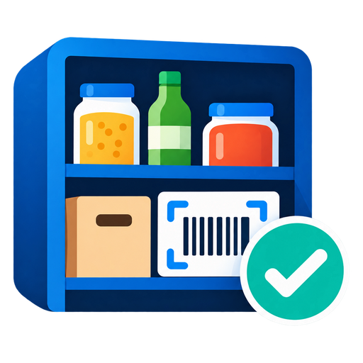

# ioBroker.shelfmate

Household inventory for ioBroker, served as an installable web app (iPhone home screen / Android) directly by the adapter.
Know what is where, get warned at minimum stock and put missing items on your shopping list automatically.

German short description: [README.de.md](README.de.md)

---

## Features

- Scan product barcodes and storage location QR codes with the phone camera
- Product master data from Open Food Facts (name, brand, package size, Nutri-Score, categories), editable
- Storage areas and locations with printable QR codes
- Stock per location, history of all bookings, offline queue in the app
- Product groups: "Flour" from several brands counts as one item
- Optional best-before date (MHD) per product or per stocking, with warning before expiry
- Minimum stock per product or group with automatic shopping-list entry
- Shopping list modes: **off**, **script** (via data points), **Bring!** or **Bring! special** (counts quantities up instead of skipping duplicates)
- Optional removal from the shopping list when the stock is refilled and/or when the check mark is removed in the app
- Overview of everything in stock as data points (JSON and HTML table for VIS)
- JSON backup: download and import in the app
- Built-in HTTPS web server that uses the certificates of your ioBroker installation (self-signed, own or Let's Encrypt collections)
- Optional access key for the API
- The app and the HTML data points use the ioBroker system language (de, en, ru, pt, nl, fr, it, es, pl, uk, zh-cn)

## Requirements

- js-controller >= 6.0.11, admin >= 7.6.20, Node.js >= 22
- HTTPS with a certificate the phone trusts (needed for the camera scanner and the offline mode)

## Installation

Install via the ioBroker Admin UI (Adapters). Then add an instance and open `https://<host>:8120/`.

## Usage

1. Open `https://<host>:8120/` on your phone and add the page to the home screen.
2. Create storage areas and locations (Settings / Locations). Print the QR code of a location and attach it to the shelf.
3. Add products: scan the barcode (name, brand, size and Nutri-Score come from Open Food Facts) or enter them by hand. Optionally set a product group, a minimum stock and a best-before date.
4. Book stock in and out per location, or move it between locations. Scan the location QR code to select the location.
5. When the stock falls to the minimum, the product is put on the shopping list. In the overview the check mark shows which products are on the list; tapping it removes the product again (see below).

## Configuration

| Setting | Description |
| --- | --- |
| Port / bind address | Where the web server listens (default `8120`, all interfaces) |
| Use HTTPS | Uses the certificate selected below. The default is the self-signed ioBroker certificate |
| Create self-signed certificate | Button: creates a certificate for this server (host name and IP addresses, valid 825 days), stores it in the ioBroker certificates and selects it. Restart the instance afterwards |
| Certificates | Choose public / private / chained certificate of the ioBroker certificate store, or a certificate collection (for example from the `acme` adapter) |
| Access key | Optional. If set, the app asks for the key once per device |
| Shopping list mode | See below |
| Best-before date | **Off**, **per product** (one date on each product) or **per stocking** (a date for every booking of stock; removing uses the oldest date first) |
| Warn before expiry | Days before the date from which products are marked and listed in the data points |

### Best-before date

Choose the mode in the settings:

- **Off**: no best-before handling.
- **Per product**: each product has one optional date (product form). Products at or after the date are marked in the overview and detail view.
- **Per stocking**: when you book stock in you can enter a date. Several dates per product and location are kept; booking out and moving always use the oldest date first.

Products that are expired or expire within the configured warning period get a badge ("expires in 3 days" / "expired") and are listed in the data points `stats.expiring*`.

### Shopping list

- **Off**: nothing is sent.
- **Script**: the item name is written (`ack=false`) to the state you select. Optionally select a state that holds the
  current list (JSON array of objects with a `name`) so ShelfMate does not add duplicates and can show which items are already on the list.
  Optionally select a state that receives the name of items to remove (`ack=false`). Then tapping the tick in the app and the option "Remove from the list when the stock is refilled" work in this mode too.
- **Bring special**: like Bring, but an item that is already on the list is not skipped. Its quantity is counted up or merged into the specification (`Flour` → `Flour, 2` → `Flour, 3`; `Feta, 200g` and `Feta, herbs` become separate variants). Items are written one after another, and the next one waits until the Bring! adapter has reloaded the list.
- **Directly via Bring!**: choose the list in the settings (the lists of the Bring! adapter are found automatically, or type the channel such as `bring.0.<list-id>`). ShelfMate reads
  `<list>.content` and writes new items to `<list>.saveItem`, but only if the item is not already on the list.

With Bring, Bring special or Script (with a remove state) there are two independent options. Items are only removed if they are on the list, and are written to `<list>.removeItem`:

- **Remove from the list when the stock is refilled**: when the stock rises above the minimum again, the item is taken off the list (default: off).
- **Remove from the list when I untick the check mark in the app**: tapping the check mark of a listed item in the app also removes it from the list (default: on). If disabled, only the mark in the app is cleared.

### Trusting the certificate on iPhone

Camera access and the offline mode need a certificate the phone trusts. With a self-signed certificate, download the ioBroker certificate in the app (Settings), install the profile and enable full trust. A certificate from a public CA (for example Let's Encrypt via the
`acme` adapter) needs no installation.

## Datapoints

| State | Description |
| --- | --- |
| `info.connection` | `true` while the web server is running |
| `stats.products`, `stats.locations` | Counts |
| `stats.lowStockCount`, `stats.lowStockList` | Items at or below the minimum stock |
| `stats.inventory` | Everything in stock as JSON (name, amount, unit, minimum, low flag, locations) |
| `stats.inventoryHtml` | Same as a simple HTML table, e.g. for a VIS html widget |
| `stats.expiringCount`, `stats.expiring`, `stats.expiringHtml` | Products that are expired or expire within the warning period (count, JSON, HTML table) |
| `shopping.addItem` | Write an item name (`ack=false`) to put it on the shopping list |

Inventory data is stored in the adapter data directory (`shelfmate.json`), not in the object database.
A JSON backup can be downloaded and imported in the app (Settings). An import replaces all data; the previous state is kept as `shelfmate.json.bak`.

## Changelog
### 0.1.2 (2026-10-20)
- New: the app and the HTML data points follow the ioBroker system language (11 languages)
- New: button in the settings that creates a self-signed certificate
- New: Open Food Facts lookups use the app language (English as fallback)
- New: data points `stats.inventory` (JSON) and `stats.inventoryHtml` (table for VIS) with everything in stock
- New: separate options to remove items from the shopping list when refilled and when unticked in the app
- Fix: an item removed from the list in the app is no longer marked again until Bring! reports the change
- New: best-before date (off / per product / per stocking) with warning and data points `stats.expiring*`
- Fix: moving stock between locations keeps the best-before dates

### 0.1.0 (2026-10-20)
- New: initial release (inventory, barcode / QR scanner, shopping list via script / Bring! / Bring special, JSON backup)

## License
MIT License

Copyright (c) 2026 Henrik Schoenhofen <henrik.schoenhofen@icloud.com>

Permission is hereby granted, free of charge, to any person obtaining a copy of this software and associated documentation files (the "Software"), to deal in the Software without restriction, including without limitation the rights to use, copy, modify, merge, publish, distribute, sublicense, and/or sell copies of the Software, and to permit persons to whom the Software is furnished to do so, subject to the following conditions:

The above copyright notice and this permission notice shall be included in all copies or substantial portions of the Software.

THE SOFTWARE IS PROVIDED "AS IS", WITHOUT WARRANTY OF ANY KIND, EXPRESS OR IMPLIED, INCLUDING BUT NOT LIMITED TO THE WARRANTIES OF MERCHANTABILITY, FITNESS FOR A PARTICULAR PURPOSE AND NONINFRINGEMENT. IN NO EVENT SHALL THE AUTHORS OR COPYRIGHT HOLDERS BE LIABLE FOR ANY CLAIM, DAMAGES OR OTHER LIABILITY, WHETHER IN AN ACTION OF CONTRACT, TORT OR OTHERWISE, ARISING FROM, OUT OF OR IN CONNECTION WITH THE SOFTWARE OR THE USE OR OTHER DEALINGS IN THE SOFTWARE.
