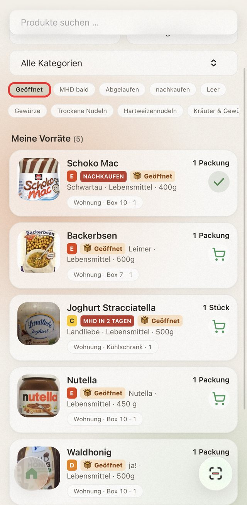
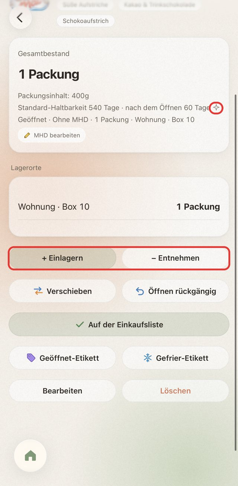
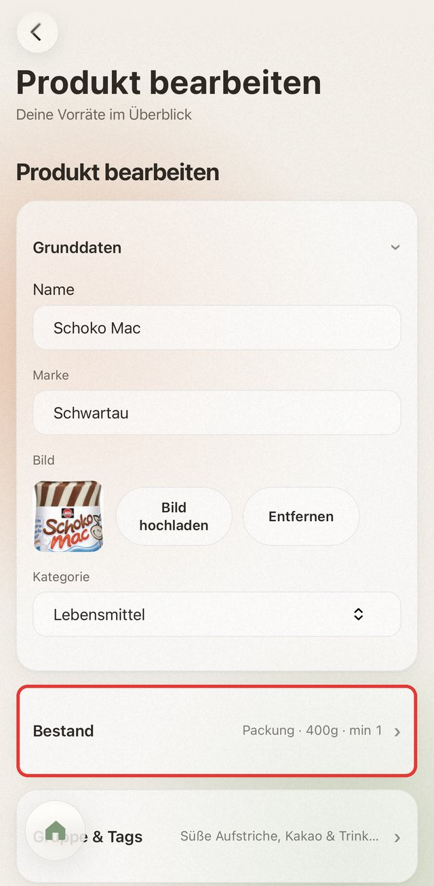
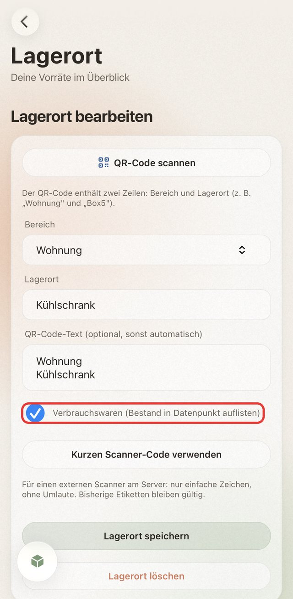
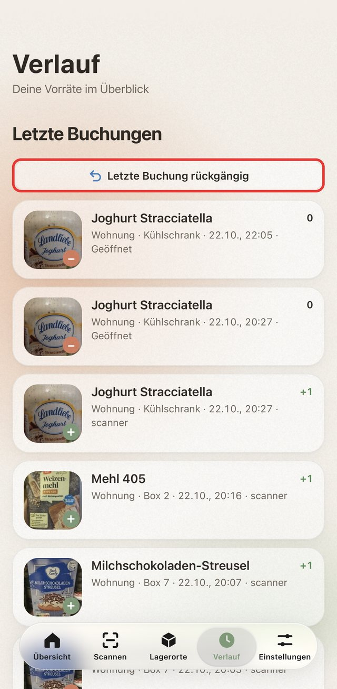
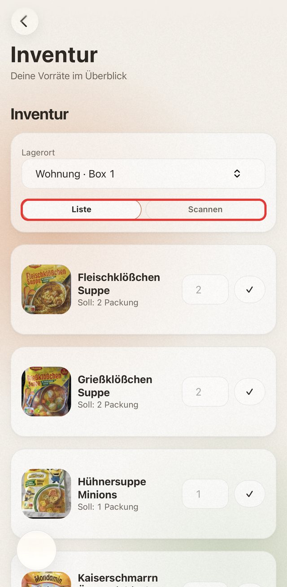
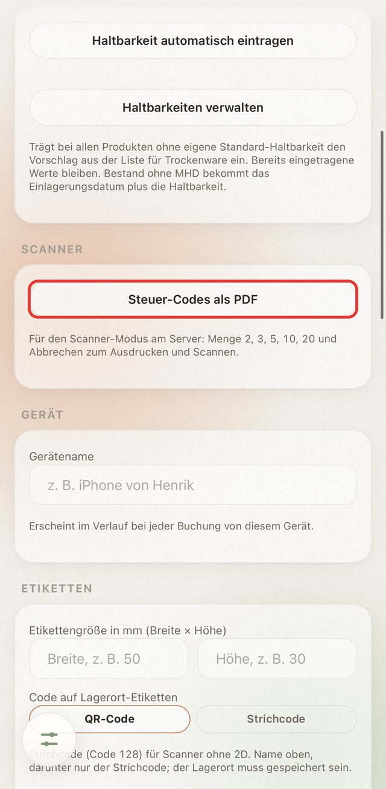

# ShelfMate – Anleitung

Mit ShelfMate verwaltest du deine Vorräte direkt in ioBroker. Diese Anleitung zeigt dir, wie du Produkte anlegst, Bestände verwaltest, Barcodes scannst und die verschiedenen Funktionen nutzt.

Alle Einstellungen, Voraussetzungen und Datenpunkte findest du in der [README](../../README.de.md).

English version: [Tutorial](../en/tutorial.md)

---

## Inhalt

1. [Die App im Überblick](#die-app-im-überblick)
2. [Produkte bearbeiten](#produkte-bearbeiten)
3. [Automatische Haltbarkeit und Funken-Symbol](#automatische-haltbarkeit-und-funken-symbol)
4. [Produktdaten aktualisieren](#produktdaten-aktualisieren)
5. [Einlagern, entnehmen und verschieben](#einlagern-entnehmen-und-verschieben)
6. [Lagerorte anlegen](#lagerorte-anlegen)
7. [Produkte ohne Barcode](#produkte-ohne-barcode)
8. [Mindestbestand und Einkaufsliste](#mindestbestand-und-einkaufsliste)
9. [Mindesthaltbarkeit](#mindesthaltbarkeit)
10. [Einkaufslisten-Modi](#einkaufslisten-modi)
11. [Zutaten prüfen](#zutaten-prüfen)
12. [Ein ganzes Regal einräumen](#ein-ganzes-regal-einräumen)
13. [Inventur durchführen](#inventur-durchführen)
14. [Scanner-Modus ohne App](#scanner-modus-ohne-app)
15. [Vorschläge](#vorschläge)
16. [Benachrichtigungen](#benachrichtigungen)
17. [Export und Backup](#export-und-backup)
18. [Offline-Modus](#offline-modus)
19. [HTTPS und Zertifikate](#https-und-zertifikate)
20. [Etiketten drucken](#etiketten-drucken)

---

## Die App im Überblick

### Übersicht

Auf der Startseite siehst du deine Produkte und deren Bestand.

Über die Suche findest du Produkte anhand von Namen, Marken oder Tags. Bereits während der Eingabe erscheinen passende Vorschläge. Mit × kannst du die Suche zurücksetzen.

Zusätzlich stehen verschiedene Filter zur Verfügung:

- Bereich: Zeigt nur Produkte aus einem bestimmten Lagerbereich.
- Lagerort: Filtert nach einem einzelnen Regal, Schrank oder Fach.
- Kategorie: Zeigt Produkte einer bestimmten Kategorie.
- Status: Filtert nach geöffneten, bald ablaufenden, abgelaufenen, nachzukaufenden oder leeren Produkten.
- Tags: Häufig verwendete Suchbegriffe lassen sich direkt auswählen.

Ein erneuter Tipp auf einen aktiven Status oder Tag hebt den jeweiligen Filter wieder auf.

Produktgruppen werden zusammengefasst dargestellt. Über das kleine Dreieck kannst du die enthaltenen Produkte aufklappen.

Die Liste ist sortiert: Zuerst kommen Produkte, die bald ablaufen oder abgelaufen sind, danach geöffnete Produkte, danach alle anderen (nachzukaufende zuerst). Leere Produkte stehen ganz unten.

Beim Zurückkehren von einer Produktseite landest du wieder an deiner vorherigen Position in der Übersicht.

<p align="center"><br><sub>Die Status-Filter und Tags über der Liste. Der rote Rahmen zeigt den aktiven Filter „Geöffnet“.</sub></p>

Der Scan-Knopf liegt auf jedem Reiter über der Leiste und klappt beim Scrollen zusammen. Wer ihn nicht braucht, schaltet ihn unter Einstellungen → Bedienung → Scan-Knopf aus. Die Einstellung gilt nur für dieses Gerät.

### Produktseite

Auf der Produktseite findest du den Gesamtbestand, die Lagerorte und – sofern aktiviert – die Haltbarkeitsdaten.

Abgelaufene und bald ablaufende Produkte werden farblich hervorgehoben.

Sind Standardwerte vorhanden, zeigt ShelfMate beispielsweise:

Standard-Haltbarkeit 365 Tage · nach dem Öffnen 90 Tage

Darunter stehen die verfügbaren Aktionen in fester Reihenfolge:

1. Einlagern / Entnehmen
2. Verschieben / Öffnen / Öffnen rückgängig, sofern verfügbar
3. Zur Einkaufsliste – bei bereits eingetragenen Produkten mit Haken
4. Etiketten drucken – welche Knöpfe erscheinen, stellst du in den Instanz-Einstellungen im ioBroker-Admin unter „Etiketten“ ein
5. Bearbeiten / Löschen

---

<p align="center"><br><sub>Die Produktseite mit Bestand, Lagerorten und Knöpfen. Das Funkel-Symbol (rot) zeigt eine automatisch eingetragene Haltbarkeit.</sub></p>

## Produkte bearbeiten

Über Bearbeiten öffnest du die Produkteinstellungen.

Wenn du ein Produkt von Hand anlegst, schlägt ShelfMate beim Tippen des Namens passende Produkte aus einer fertigen Liste vor. Wenn du zum Beispiel `Sch` eingibst, erscheint unter anderem Schokolade. Ein Tipp auf den Vorschlag übernimmt den Namen und setzt die Kategorie, falls du noch keine gewählt hast. Bei Produkten aus Open Food Facts gibt es keine Vorschläge, dort kommt der Name von dort.

Das Formular ist in fünf aufklappbare Bereiche unterteilt. Geschlossene Bereiche zeigen eine kurze Zusammenfassung, beispielsweise `Packung · 400g · min 1`.

| Bereich | Einstellungen |
| --- | --- |
| Grunddaten | Produktname, Marke, Bild und Kategorie |
| Bestand | Stück, Gewicht oder Volumen, Einheit, Packungsinhalt und Mindestbestand |
| Gruppe & Tags | Produktgruppe und zusätzliche Suchbegriffe |
| Haltbarkeit | MHD, Standard-Haltbarkeit und Haltbarkeit nach dem Öffnen |
| Mehr | Barcode, eigene EAN, Nutri-Score, Bild-Link und Open Food Facts |

Die Grunddaten sind standardmäßig geöffnet, bei neuen Produkten zusätzlich der Bereich „Bestand“.

<p align="center"><br><sub>Der Editor hat zuklappbare Bereiche, zum Beispiel Grunddaten und Bestand.</sub></p>

### Produktgruppen

Mehrere Produkte lassen sich zu einer Gruppe zusammenfassen.

Beispiel: Weizenmehl von REWE, Edeka und Kaufland gehört zur gemeinsamen Gruppe Mehl.

ShelfMate zählt den Bestand dieser Produkte zusammen und berücksichtigt ihn beim Mindestbestand.

Hat ein Produkt keine eigene Standard-Haltbarkeit, kann der Wert der Gruppe verwendet werden.

### Nutri-Score

Der Nutri-Score lässt sich im Bereich Mehr über die farbigen Knöpfe A bis E auswählen.

Ein erneuter Tipp auf den ausgewählten Wert entfernt ihn wieder.

---

## Automatische Haltbarkeit und Funken-Symbol

ShelfMate kann Haltbarkeitswerte automatisch vorschlagen oder eintragen.

Dazu gehören:

- Standard-Haltbarkeit eines Produkts
- Haltbarkeit nach dem Öffnen
- Automatisch berechnete Haltbarkeitsdaten beim Einlagern

### Was bedeutet das Funken-Symbol?

Das kleine ✨ Funken-Symbol auf der Produktseite kennzeichnet automatisch übernommene Werte.

Es erscheint beispielsweise, wenn die Haltbarkeit aus der eingebauten Lebensmittelliste oder einer Produktgruppe stammt oder ein MHD automatisch berechnet wurde.

Selbst eingetragene Werte haben immer Vorrang.

Änderst du ein automatisch vorgeschlagenes Datum selbst, gilt es anschließend als manueller Wert. Das Symbol verschwindet, sobald keine automatischen Werte mehr vorhanden sind.

Das Symbol wird nur auf der Produktseite angezeigt, nicht in der Übersicht.

Ältere automatisch berechnete Daten kann ShelfMate beim erneuten Ausführen von Haltbarkeit automatisch eintragen wieder erkennen, wenn sie genau dem Einlagerungsdatum plus Standard-Haltbarkeit entsprechen.

### Wann wird die Haltbarkeit eingetragen?

Das legst du in den Adapter-Einstellungen fest.

| Einstellung | Verhalten |
| --- | --- |
| Immer | Die App schlägt beim Einlagern ein Datum vor. Scanner-Modus und Datenpunkte tragen es automatisch ein |
| Nur ohne App | Automatische Eintragung nur über Scanner-Modus und Datenpunkte |
| Nie | Keine automatische Eintragung und keine automatischen Vorschläge |

Bei Nie bleibt die Funktion Haltbarkeit automatisch eintragen weiterhin manuell nutzbar.

### Welche Werte werden verwendet?

Zusätzlich gibt es zwei Möglichkeiten:

**Alles mit Standard-Haltbarkeit**

Berücksichtigt eigene Werte am Produkt, Werte der Produktgruppe und die eingebaute Liste.

**Nur Trockenware aus der eingebauten Liste**

Verwendet ausschließlich die hinterlegten Standardwerte für typische Vorratsprodukte. Eigene Produkt- und Gruppenwerte werden dabei nicht automatisch eingetragen.

Die eingebaute Liste enthält beispielsweise Nudeln, Reis, Mehl, Konserven und Süßwaren.

Frische und gekühlte Produkte wie Milch, Fleisch, Wurst, Käse, Eier oder Joghurt erhalten bewusst keinen automatisch berechneten Standardwert.

Wichtig: Automatische Haltbarkeiten sind Richtwerte und kein tatsächliches Hersteller-MHD. Ein aufgedrucktes oder manuell eingetragenes Datum hat Vorrang. Auch durch das Öffnen einer Packung wird ein früheres Datum niemals verlängert.

### Haltbarkeitswerte verwalten

Unter Einstellungen → Haltbarkeit → Haltbarkeiten verwalten findest du alle Produkte mit eigenen Haltbarkeitswerten.

Dort kannst du Werte bearbeiten, einzeln über × entfernen oder über Alle eigenen Werte entfernen gesammelt löschen.

Änderungen werden direkt übernommen.

---

## Produktdaten aktualisieren

Produkte mit einem bekannten Barcode können ihre Informationen von Open Food Facts beziehen.

Im Produkteditor findest du unter Mehr die Funktion Von Open Food Facts neu laden.

Dabei werden folgende Angaben aktualisiert:

- Name und Marke
- Packungsinhalt
- Produktbild
- Kategorie
- Nutri-Score
- Zusätzliche Tags

Bereits selbst angelegte Tags bleiben erhalten.

Die Änderungen werden erst mit Produkt speichern übernommen. Du kannst das Ergebnis also vorher prüfen und das Formular bei Bedarf ohne Speichern schließen.

Bei Produkten aus Open Food Facts ist der Barcode im Editor gesperrt.

---

## Einlagern, entnehmen und verschieben

So funktioniert eine normale Buchung:

1. Unten rechts in der Übersicht auf Scannen tippen und den Barcode mit der Kamera erfassen oder manuell eingeben.
2. Bei bekannten Produkten öffnet sich die Produktseite.
3. Unbekannte Barcodes werden über Open Food Facts gesucht. Die gefundenen Angaben können geprüft und gespeichert werden.
4. Einlagern, Entnehmen oder Verschieben auswählen.
5. Menge und Lagerort festlegen und die Buchung speichern.

Den Lagerort kannst du entweder aus der Liste auswählen oder direkt über seinen QR-Code scannen.

Alle Buchungen werden in der Historie gespeichert.

---

## Lagerorte anlegen

ShelfMate unterscheidet zwischen Lagerbereichen und Lagerorten.

Beispiel:

- Bereich: Speisekammer
- Lagerort: Regal 1

Unter Lagerorte kannst du beides anlegen und bearbeiten.

<p align="center"><br><sub>Ein Lagerort mit seinem QR-Code-Text. Die Checkbox „Verbrauchswaren“ listet den Bestand dieses Lagerorts in einem Datenpunkt auf.</sub></p>

### Verbrauchswaren

Beim Bearbeiten eines Lagerorts, zum Beispiel des Kühlschranks, „Verbrauchswaren“ ankreuzen. Der Bestand aller angekreuzten Lagerorte steht dann in zwei Datenpunkten:

| Datenpunkt | Beschreibung |
| --- | --- |
| `stats.consumables` | JSON-Liste mit Name, Marke, Menge, Einheit, Lagerorten, geöffneter Menge, nächstem MHD, Resttagen und `expiring` |
| `stats.consumablesText` | Eine Zeile pro Produkt, zum Beispiel `2 Stück Joghurt (1 geöffnet, MHD 2026-10-25)` |

Der Text zeigt geöffnete Menge und MHD nur, wenn etwas geöffnet ist oder bald abläuft. Das ist praktisch, um Rezepte zu planen oder für eigene Skripte.

### QR-Codes für Lagerorte

Jeder Lagerort bekommt einen eigenen Code.

Öffne den Lagerort und wähle das gewünschte Etikett:

- Nur QR-Code
- Großes Regal-Etikett
- Boxen-Etikett mit Inhalt

Alternativ kannst du Lagerort-Etiketten auch mit einem Code-128-Strichcode erstellen. Das ist besonders praktisch für Scanner ohne QR-Code-Unterstützung.

Die Codeart lässt sich unter Einstellungen → Etiketten auswählen.

### Etikettengröße

Die Größe der Etiketten legst du einmalig fest, beispielsweise auf 50 × 30 mm.

Für große Regal-Etiketten, Boxen-Etiketten und vollflächige Codes sind auch eigene Formate wie A6, A5 oder A4 möglich.

Welche Etiketten-Knöpfe in der App angezeigt werden, wählst du in den Instanz-Einstellungen im ioBroker-Admin unter „Etiketten-Knöpfe in der App“. Die Etikettengröße stellst du direkt in den App-Einstellungen ein.

Nach dem Erstellen kannst du das Etikett als Bild speichern oder direkt drucken.

---

## Produkte ohne Barcode

Auch Produkte ohne Herstellerbarcode lassen sich verwalten.

1. Produkt manuell anlegen.
2. Im Editor EAN erzeugen auswählen.
3. Den eigenen EAN-13-Code als Etikett drucken.
4. Etikett auf das Produkt oder den Behälter kleben.

Anschließend lässt sich das Produkt wie jedes andere scannen.

Zusätzlich kannst du ein eigenes Produktbild hochladen. ShelfMate verkleinert es automatisch.

---

## Mindestbestand und Einkaufsliste

Für jedes Produkt kannst du einen Mindestbestand festlegen.

Beispiel: Du möchtest immer mindestens zwei Packungen Nudeln im Vorrat haben.

Sobald der Bestand auf zwei Packungen oder weniger fällt, kann ShelfMate die Nudeln automatisch auf deine Einkaufsliste setzen.

Bei Produktgruppen werden die Bestände der zugehörigen Produkte gemeinsam berücksichtigt.

In der Übersicht zeigt ein Haken an, welche Produkte bereits auf der Einkaufsliste stehen. Durch Antippen kann der Eintrag wieder entfernt werden, sofern die entsprechenden Einstellungen aktiv sind.

Die Verbindung zur Einkaufsliste wird in den Adapter-Einstellungen eingerichtet.

### Fehlende Menge schreiben

Mit der Option „Fehlende Menge auf die Liste schreiben“ (Bring! Spezial und Skript-Modus) schreibt ShelfMate auch, wie viele fehlen. Beispiel: Mindestbestand 5 bei Mehl.

- Der Bestand fällt auf 5: Die Liste bekommt `Mehl, 1`.
- Der Bestand fällt weiter auf 3: Es wird nur die Differenz ergänzt. Bei Bring! Spezial wird daraus `Mehl, 3`. Im Skript-Modus bekommt dein Skript `Mehl, 2` und addiert die Menge selbst.
- Der Bestand fällt von 8 direkt auf 3: Die Liste bekommt `Mehl, 2`.

---

## Mindesthaltbarkeit

ShelfMate unterstützt drei Modi.

| Modus | Beschreibung |
| --- | --- |
| Aus | Keine MHD-Verwaltung |
| Pro Produkt | Ein gemeinsames MHD für das Produkt |
| Pro Einlagerung | Jede Einlagerung kann ein eigenes MHD haben |

### MHD pro Einlagerung

Beim Einlagern kann jeder Packung ein eigenes Datum zugewiesen werden.

Mehrere Haltbarkeitsdaten werden pro Produkt und Lagerort getrennt gespeichert.

Beim Entnehmen oder Verschieben wird zuerst der Bestand mit dem ältesten MHD berücksichtigt.

Fehlt ein Datum, kann ShelfMate anhand der Standard-Haltbarkeit automatisch eines berechnen. Dafür wird das Einlagerungsdatum aus der Historie verwendet.

### Packung öffnen

Mit Öffnen kannst du eine einzelne Packung als geöffnet markieren.

ShelfMate führt diese Packung anschließend separat und berücksichtigt sie bei der Entnahme zuerst.

Ist eine Haltbarkeit nach dem Öffnen hinterlegt, wird daraus ein neues Datum berechnet. Ein früheres vorhandenes MHD bleibt bestehen.

Mit Öffnen rückgängig kannst du den Vorgang zurücksetzen.

### Verdorbene Produkte

Beim Entnehmen kannst du zwischen Verbraucht und Verdorben unterscheiden.

Verdorbene Produkte zählen nicht zum normalen Verbrauch. In der Historie werden sie für 30 Tage zusammengefasst.

### Buchungen rückgängig machen

Über die Historie kannst du die letzte Buchung rückgängig machen.

Im Scanner-Modus steht dafür der Steuer-Code `SM:UNDO` zur Verfügung.

Dort gilt die Funktion nicht für Verschiebungen und Inventuren.

<p align="center"><br><sub>Der Verlauf mit dem Knopf, der die letzte Buchung rückgängig macht.</sub></p>

### MHD nachträglich ändern

Im Modus Pro Einlagerung zeigt MHD bearbeiten alle Packungen einzeln an – auch geöffnete.

Du kannst ein Datum manuell eingeben oder die Schnellwahl verwenden:

- +1 Tag
- +3 Tage
- +5 Tage
- +10 Tage
- Kein Datum

Mit Speichern werden alle Änderungen übernommen. Die Anpassungen erscheinen in der Historie und lassen sich rückgängig machen.

Im Scanner-Modus kannst du mit `SM:DATE:<Tage>` und anschließendem Produktscan ein neues MHD für den gesamten ungeöffneten Bestand setzen.

`SM:DATE:0` entfernt das Datum.

### Datum schnell eingeben

ShelfMate versteht neben normalen Datumsangaben auch Kurzformen.

| Eingabe | Bedeutung |
| --- | --- |
| +3d | In 3 Tagen |
| +2w | In 2 Wochen |
| +1m | In einem Monat |
| +1y | In einem Jahr |
| 12/26 | Ende Dezember 2026 |
| 2412 | Nächster 24. Dezember |
| 24.12. | Nächster 24. Dezember |
| 24.12.26 | 24. Dezember 2026 |
| x | Kein Datum |

Unter dem Eingabefeld erscheint eine Vorschau des erkannten Datums.

Zusätzlich gibt es Schnellwahl-Knöpfe für +1 bis +14 Tage, +3 Wochen, +1 Monat, +3 Monate, +6 Monate und +1 Jahr.

### Ablaufwarnungen

Bald ablaufende und abgelaufene Produkte werden in der App gekennzeichnet, beispielsweise mit:

- „Läuft in 3 Tagen ab“
- „Abgelaufen“

Die Informationen stehen außerdem in den Datenpunkten `stats.expiring*` bereit.

Unter Datumsformat kannst du zwischen 31.10.2026, 31/10/2026 und 2026-10-31 wählen.

---

## Einkaufslisten-Modi

ShelfMate unterstützt vier Möglichkeiten, Produkte auf eine Einkaufsliste zu setzen.

### Aus

Es werden keine Produkte automatisch an eine Einkaufsliste übertragen.

### Script

ShelfMate schreibt den Artikelnamen mit `ack=false` in einen frei wählbaren Datenpunkt.

Optional kannst du zusätzlich einen Datenpunkt mit der aktuellen Einkaufsliste angeben. Erwartet wird ein JSON-Array mit Objekten, die jeweils einen `name` enthalten. So muss der Inhalt aussehen:

```json
[
  { "name": "Mehl" },
  { "name": "Milch" },
  { "name": "Feta" }
]
```

Damit erkennt ShelfMate bereits vorhandene Produkte und vermeidet doppelte Einträge.

Die Objekte dürfen weitere Felder enthalten, zum Beispiel eine Menge oder eine Beschreibung. ShelfMate liest nur den `name` und ignoriert den Rest.

Ist „Fehlende Menge schreiben“ aktiv, schreibt ShelfMate statt des reinen Namens den Text `Name, Menge` in den Datenpunkt, zum Beispiel `Milch, 2`. Dein Script trennt den Text am Komma und rechnet die Mengen selbst zusammen, denn ShelfMate prüft in diesem Fall nicht auf doppelte Einträge.

Alternativ liest dein Script den Datenpunkt `shopping.lastItem`. Darin steht der zuletzt hinzugefügte Artikel als JSON, ohne dass du Text trennen musst:

```json
{ "name": "Mehl", "quantity": 500, "unit": "g", "text": "500 g" }
```

`quantity` ist eine Zahl oder `null`, `unit` ist leer, wenn keine Einheit dabei war. Der Datenpunkt wird nur im Script-Modus gefüllt.

Für das Entfernen von Artikeln lässt sich ein weiterer Datenpunkt festlegen. Auch dort wird der Artikelname mit `ack=false` geschrieben.

Erst mit diesem Datenpunkt funktionieren das Entfernen über den Haken in der App und die automatische Entfernung nach dem Auffüllen.

### Bring!

ShelfMate kann direkt mit dem Bring!-Adapter zusammenarbeiten.

Die verfügbaren Listen werden automatisch erkannt. Alternativ kannst du den Kanal manuell eintragen, beispielsweise:

```
bring.0.<list-id>
```

ShelfMate liest den Listeninhalt über `<Liste>.content` und fügt neue Produkte über `<Liste>.saveItem` hinzu.

Produkte, die bereits auf der Liste stehen, werden nicht erneut eingetragen.

Bei einem Eintrag mit Komma wird nur der Artikelname vor dem ersten Komma übernommen.

### Bring! Spezial

Dieser Modus berücksichtigt zusätzlich Mengen und Zusätze.

Beispiele:

- `Mehl` → `Mehl, 2` → `Mehl, 3`
- `Feta, 200g` und danach `Feta, Kräuter` ergeben **einen** Eintrag: `Feta, Kräuter, 200g`. Du siehst also: ein Feta mit 200 g und ein Feta als Kräutervariante
- Kommt noch ein `Feta, Kräuter` dazu, steht dort `Feta, Kräuter 2, 200g`

Bereits vorhandene Artikel werden also nicht einfach übersprungen. Stattdessen erhöht ShelfMate die Menge oder ergänzt den Zusatz.

Die Einträge werden nacheinander verarbeitet. Der nächste Artikel wird erst übertragen, wenn der Bring!-Adapter seine Liste aktualisiert hat.

Das ist besonders bei der Zutaten-Prüfung hilfreich.

### Datenpunkt shopping.addItem

Über `shopping.addItem` kannst du unabhängig von der App Produkte auf die Einkaufsliste setzen.

Dabei wird immer der aktuell eingestellte Einkaufslisten-Modus verwendet.

### Produkte automatisch entfernen

Bei Bring!, Bring! Spezial und Script mit eingerichtetem Entfernen-Datenpunkt stehen zwei unabhängige Optionen zur Verfügung:

**Von der Liste nehmen, wenn wieder aufgefüllt**

Sobald der Bestand wieder über den Mindestbestand steigt, wird das Produkt von der Einkaufsliste entfernt.

Standardmäßig ausgeschaltet.

**Von der Liste nehmen, wenn der Haken entfernt wird**

Ein Tipp auf den Haken in der App entfernt das Produkt auch von der verbundenen Einkaufsliste.

Ist die Funktion deaktiviert, verschwindet nur die Markierung in ShelfMate.

Standardmäßig eingeschaltet.

Entfernt werden nur Artikel, die tatsächlich auf der Liste stehen. Bei Bring! erfolgt die Entfernung über `<Liste>.removeItem`.

---

## Zutaten prüfen

ShelfMate kann eine Zutatenliste mit deinem aktuellen Vorrat vergleichen.

Die Rezepte selbst werden nicht in ShelfMate gespeichert. Stattdessen übergibst du eine Zutatenliste, beispielsweise aus einer Rezept-App.

### Zutaten übergeben

Schreibe die Zutaten in den Datenpunkt `check.request` mit `ack=false`.

Möglich sind:

- Eine Zutat pro Zeile
- Zutaten mit Semikolon getrennt
- Ein JSON-Array aus Texten
- Ein JSON-Array aus Objekten mit name, amount und unit

Beispiele:

```
Zwiebeln, rot, 1
Cherrytomaten, bunt, 500g
Salz, 0.5 tl
Basilikum
```

Auch diese Schreibweisen werden erkannt:

```
380g Linguine
2EL Olivenöl
Mehl 200g
```

Unterstützte Mengeneinheiten sind kg, g, l, ml, cl und Stück.

Angaben wie EL oder TL werden nur auf Vorhandensein geprüft.

Gleiche Zutaten werden zusammengerechnet.

### So funktioniert der Abgleich

ShelfMate sucht über Produktnamen, Gruppen und Tags.

Dabei werden ganze Wörter verglichen.

Beispiel: Cherrytomaten wird nicht automatisch als Tomaten erkannt. Ein entsprechender Tag am Produkt reicht jedoch aus.

Bei Produkten mit Gewicht oder Volumen wird der tatsächliche Bestand berücksichtigt.

Beispiel: 500 g Mehl vorhanden, 200 g benötigt – die Zutat ist verfügbar.

Packungsgrößen wie 1 kg werden entsprechend umgerechnet.

Bei Zutaten ohne Mengenangabe reicht ein positiver Bestand.

Unbekannte Zutaten gelten als fehlend. Dadurch können auch andere Einkaufsartikel übernommen werden.

### Ergebnis

Nach jeder Prüfung stehen folgende Datenpunkte bereit:

| Datenpunkt | Inhalt |
| --- | --- |
| `check.result` | Ergebnis für jede einzelne Zutat als JSON |
| `check.available` | Vorhandene Zutaten |
| `check.missing` | Fehlende Zutaten |
| `check.allAvailable` | true, wenn alles vorhanden ist |

Die Listen enthalten die ursprünglichen Zutatenzeilen, jeweils eine pro Zeile.

Mit `check.addMissing` kannst du die fehlenden Zutaten auf die Einkaufsliste setzen.

Alternativ aktivierst du in den Adapter-Einstellungen Fehlende Zutaten auf die Einkaufsliste setzen. Dann erfolgt die Übertragung automatisch nach jeder Prüfung.

Bring! Spezial berücksichtigt dabei auch Mengen und Zusätze, während die anderen Modi nur den Artikelnamen übertragen.

### Mindestbestand berücksichtigen

ShelfMate kann beim Zutatenabgleich auch den gewünschten Mindestbestand einrechnen.

Beispiel:

- Vorrat: 2 kg Zucker
- Mindestbestand: 1 kg
- Benötigt: 3 kg Zucker

Auf der Einkaufsliste landen 2 kg Zucker, damit nach dem Kochen der Mindestbestand erhalten bleibt.

Nach jeder Prüfung wird `check.request` automatisch geleert.

---

## Ein ganzes Regal einräumen

Über Lagerorte → Einräumen kannst du mehrere Produkte nacheinander erfassen und gemeinsam einlagern.

1. Lagerort per QR-Code scannen oder aus der Liste auswählen.
2. Produkte nacheinander scannen, mit Kamera, externem Scanner oder durch Eingabe der EAN.
3. Jeder Scan erhöht die Menge um 1.
4. Mengen bei Bedarf in der Liste korrigieren.
5. Zum Abschließen denselben Lagerort-Code erneut scannen oder Einlagern auswählen.

Alle erfassten Produkte werden gemeinsam eingebucht.

Bei Produkten nach Gewicht oder Volumen zählt jeder Scan als ganze Packung. Dafür muss die Packungsgröße in g oder ml hinterlegt sein.

### Unbekannte Produkte

Ist ein Barcode noch nicht bekannt, fragt ShelfMate die Produktdaten bei Open Food Facts ab und legt das Produkt an.

Wird dort nichts gefunden, erstellt ShelfMate vorläufig einen Eintrag wie:

```
Unbekanntes Produkt 1234567890123
```

Das Produkt wird trotzdem mitgezählt.

In den Einstellungen erscheint anschließend der Hinweis Neue Produkte bearbeiten, bis der Eintrag ergänzt und gespeichert wurde.

---

## Inventur durchführen

Mit der Inventur kannst du überprüfen, ob der gespeicherte Bestand mit dem tatsächlichen Vorrat übereinstimmt.

Es gibt zwei Varianten: Scannen und Liste.

### Inventur per Scan

1. Unter Lagerorte → Inventur die Variante Scannen auswählen.
2. QR-Code des Lagerorts scannen.
3. Alle vorhandenen Produkte nacheinander scannen.
4. Jeder Scan zählt ein Stück. Derselbe Barcode kann mehrfach gescannt werden.
5. Zum Abschluss denselben Lagerort-QR erneut scannen.

ShelfMate gleicht die gezählten Mengen mit dem gespeicherten Bestand ab und zeigt eine Zusammenfassung.

Abweichungen werden mit Soll- und Istmenge angezeigt.

Nicht gescannte Produkte werden mit Bestand 0 gezählt.

Anschließend kannst du mit dem nächsten Lagerort weitermachen. Ein neuer Lagerort wird erst angenommen, wenn der vorherige abgeschlossen ist.

In der Übersicht siehst du, welche Lagerorte bereits geprüft wurden und welche noch offen sind.

### Inventur über die Liste

Alternativ kannst du die vorhandenen Produkte direkt in einer Liste prüfen.

- Tatsächliche Menge eingeben
- Mit ✓ bestätigen, wenn der Bestand stimmt

Bestandskorrekturen werden in der Historie als Inventur gespeichert.

Eine regelmäßige Inventur-Erinnerung lässt sich in den Adapter-Einstellungen aktivieren.

---

<p align="center"><br><sub>Inventur: Lagerort wählen und die Produkte in einer Liste oder per Scan prüfen.</sub></p>

## Scanner-Modus ohne App

ShelfMate unterstützt das Ein- und Auslagern über einen externen Barcode-Scanner, ohne dass die Web-App geöffnet sein muss.

Der Scanner-Modus wird über `scanner.active` aktiviert.

Scans können über `scanner.input` mit `ack=false` übergeben oder von einem direkt am ioBroker-Host angeschlossenen Scanner empfangen werden.

### Scanabläufe

| Scanfolge | Aktion |
| --- | --- |
| Produkt → Lagerort | 1 Stück einlagern |
| Produkt → Produkt | 1 Stück entnehmen |
| Produkt → Produkt → Lagerort | 1 Stück aus einem bestimmten Lagerort entnehmen |
| Lagerort | Einräum-Modus starten |
| Lagerort erneut | Einräum-Modus beenden |
| Anderer Lagerort | Im Einräum-Modus den Lagerort wechseln |

Wird beim Entnehmen kein Lagerort angegeben, wählt ShelfMate den Bestand mit dem kürzesten MHD.

Ist kein MHD vorhanden, wird der Lagerort mit der größten Menge verwendet.

### Mehrfach scannen

Ein Scan wartet auf einen Lagerort, zwei Scans entnehmen. Ab drei Scans desselben Produkts hintereinander führt ShelfMate eine Aktion aus, die du selbst festlegst.

Die Aktionen stellst du in den Adapter-Einstellungen unter „Aktionen bei mehrfachem Scannen“ ein. Pro Anzahl gibt es eine Zeile, jede Anzahl von 3 bis 20 kann einmal vergeben werden.

| Aktion | Wirkung |
| --- | --- |
| Am letzten bekannten Lagerort einlagern | Ein Stück kommt dorthin zurück, wo das Produkt zuletzt eingelagert wurde. Ein anschließend gescannter Lagerort gilt stattdessen. |
| Mehrere am letzten Lagerort einlagern | Wie oben, aber mit der Menge aus dem Feld „Wert“. Ist es leer, zählt die Anzahl der Scans. |
| Als leer markieren | Der gesamte Bestand wird auf 0 gesetzt. Bei Mindestbestand landet das Produkt auf der Einkaufsliste. |
| Geöffnet / geschlossen umschalten | Markiert eine Packung als geöffnet, wie `SM:OPEN`, nur ohne Steuer-Code. Gibt es schon eine geöffnete Packung, schließt derselbe Scan sie wieder. |
| Auf die Einkaufsliste setzen | Das Produkt wird vorgemerkt. Das Feld „Wert“ kann eine Menge enthalten. |
| Von der Einkaufsliste entfernen | Das Produkt wird von der Liste genommen. |

Voreingestellt sind dreimal scannen = am letzten Lagerort einlagern, viermal = als leer markieren und fünfmal = auf die Einkaufsliste setzen. Ein- und zweimaliges Scannen bleibt unverändert.

Ab dem dritten Scan muss jeder Scan innerhalb der Zeit zwischen wiederholten Scans folgen (Standard 3 Sekunden). Wird es länger, beginnt das Zählen von vorn und die bisherigen Scans werden als Entnahme gebucht.

Jede ausgelöste Aktion steht im Log und im Datenpunkt `scanner.lastAction` mit der Anzahl der Scans, zum Beispiel `3x: Nudeln ×1 eingelagert in Vorratsregal`. Darüber kannst du eine Sprachausgabe oder eine Benachrichtigung auslösen. Die Buchungen erscheinen außerdem im Verlauf.

### Unbekannte Produkte im Scanner-Modus

Ist ein gescannter Barcode noch nicht bekannt, legt ShelfMate das Produkt selbst an, bevor es gebucht wird. Die Daten (Name, Marke, Kategorie und Tags) kommen von Open Food Facts, auch aus den Datenbanken für Kosmetik und Tiernahrung. Danach wird der Scan wie gewohnt gebucht.

Wird nichts gefunden, legt ShelfMate das Produkt als unvollständig mit einem Namen wie `Neues Produkt 1234567890123` an und bucht es trotzdem. Das Scanner-Ergebnis weist darauf hin. Unter Aufgaben → Neue Produkte bearbeiten kannst du diese Einträge später ergänzen.

### Scanner mit Speicher

Manche Scanner merken sich Scans außerhalb der Reichweite und senden sie später alle auf einmal. ShelfMate trennt einen solchen Schwung in einzelne Scans und verarbeitet sie in der gescannten Reihenfolge. Auch eine Abfolge wie Lagerort → Produkte → Lagerort (Einräum-Modus) funktioniert. Dauert die Abfrage vieler unbekannter Produkte länger als die Wartezeit zwischen zwei Scans, die Wartezeit erhöhen.

### Einräum-Modus

Scanne zuerst den Lagerort-Code.

Anschließend kannst du beliebig viele Produkte scannen. Jeder Produktscan bucht sofort ein Stück in den ausgewählten Lagerort ein.

Zum Beenden denselben Lagerort-Code erneut scannen.

Ein anderer Lagerort-Code wechselt direkt den Lagerort.

Nach fünf Minuten ohne Scan endet der Modus automatisch.

### MHD beim Einräumen

Mehrere Produkte mit demselben Datum musst du nicht einzeln eintragen.

1. Lagerort-Code scannen, das startet den Einräum-Modus.
2. `SM:DATE:7` scannen, das bedeutet „heute plus 7 Tage“.
3. Alle Produkte scannen. Jedes wird eingelagert und bekommt das Datum gleich dazu. Für mehrere gleiche Packungen vorher `SM:QTY:3` scannen.
4. Für ein anderes Datum den nächsten `SM:DATE:…`-Code scannen. `SM:DATE:0` schaltet das Datum aus.
5. Zum Schluss den Lagerort erneut scannen.

Ist das Datum eines anderen Produkts richtig, scanne `SM:COPY` und dann dieses Produkt. Die folgenden Produkte im Einräum-Modus bekommen sein Datum. Außerhalb des Einräum-Modus bekommt das nächste gescannte Produkt das Datum auf seinen vorhandenen Bestand.

Ohne Einräum-Modus gilt weiterhin: `SM:DATE:7`, dann das Produkt, setzt das Datum für den Bestand, der schon im Lager liegt.

### Ohne MHD: mehrere Produkte auf einmal

Hake bei einem Lagerort „MHD beim Einlagern erfassen“ an, zum Beispiel beim Kühlschrank. Dann erscheinen die Produkte dieses Lagerorts, die noch kein Datum haben, im Reiter Aufgaben und als Filter „Ohne MHD“ in der Übersicht. Ein von ShelfMate geschätztes Datum (Funken-Symbol) zählt dabei als fehlend, bis du es bestätigst.

Gib ein Datum ein (zum Beispiel `0511` oder `+7d`), hake die Produkte an, für die es gilt, und tippe auf „Datum setzen“. Produkte in anderen Lagerorten, zum Beispiel Nudeln im Vorratsregal, erscheinen dort nicht.

### Steuer-Codes

Für weitere Aktionen gibt es spezielle Codes:

| Code | Funktion |
| --- | --- |
| `SM:UNDO` | Letzte unterstützte Buchung rückgängig machen |
| `SM:SPOIL` | Nächstes Produkt als verdorben entnehmen |
| `SM:OPEN` | Nächstes Produkt als geöffnet markieren |
| `SM:DATE:<Tage>` | MHD für den ungeöffneten Bestand setzen |
| `SM:DATE:0` | MHD entfernen |
| `SM:COPY` | MHD eines Produkts übernehmen |
| `SM:QTY:5` | Nächste Buchung mit Menge 5 durchführen |
| `SM:CANCEL` | Wartenden Scan abbrechen |

Die Steuer-Codes lassen sich über die Einstellungen als PDF drucken.

<p align="center"><br><sub>In den Einstellungen liegen die Steuer-Codes für den Scanner als PDF.</sub></p>

### Zeit zwischen zwei Scans

Unter den Adapter-Einstellungen kannst du festlegen, wie lange ShelfMate auf den nächsten Code wartet.

Möglich sind 3 bis 120 Sekunden.

Standard: 10 Sekunden.

Für mehrfaches Scannen (ab dem dritten Scan) gibt es eine eigene kurze Zeit zwischen wiederholten Scans, Standard 3 Sekunden.

### Externen Funk-Scanner anschließen

Vorgesehen ist beispielsweise der Tera HW0009 mit 2,4-GHz-Dongle.

1. Den Scanner in den Kopplungsmodus bringen und über 2,4 GHz mit dem Dongle koppeln, wie in der Anleitung des Herstellers beschrieben.
2. Den USB-Dongle am ioBroker-Rechner anschließen. Läuft ioBroker in einer virtuellen Maschine, das USB-Gerät an die VM durchreichen. Wie das geht, hängt von der Virtualisierungssoftware ab.
3. Tastaturlayout des Scanners auf US oder Deutsch und Code-Ende auf Enter einstellen. In den ShelfMate-Adapter-Einstellungen dasselbe Layout wählen (Tastaturlayout des Scanners). Scanner und Einstellung müssen übereinstimmen.
4. ioBroker das Recht geben, das Eingabegerät zu lesen (siehe unten), und ioBroker neu starten. Das Recht gilt erst nach dem Neustart.
5. In den ShelfMate-Adapter-Einstellungen das Scanner-Gerät auswählen.
6. Den Scanner-Modus über `scanner.active` aktivieren.

Der Scanner wird als USB-Tastatur erkannt. Ein zusätzlicher Treiber ist normalerweise nicht nötig.

Damit ioBroker auf das Eingabegerät zugreifen kann, muss der Benutzer die passenden Rechte haben:

```
sudo adduser iobroker input
```

Danach startest du ioBroker selbst neu, nicht nur die Instanz. Das neue Recht gilt erst danach.

Soll der Scanner Umlaute und ß lesen (zum Beispiel in Lagerortnamen), stellst du am Scanner das deutsche Tastaturlayout ein (beim Tera HW0009 der Code „Deutschland") und in den ShelfMate-Einstellungen „Tastaturlayout des Scanners" auf Deutsch. Beides muss übereinstimmen.

Falls der Scanner mit einem Präfix oder Suffix arbeitet, müssen die entsprechenden Einstellungen in ShelfMate übereinstimmen.

Jeder erkannte Code wird in `scanner.lastCode` gespeichert. Das Ergebnis steht in `scanner.result`.

### Scanner per Bluetooth anschließen

Wenn der Scanner weit weg vom ioBroker-Rechner stehen soll (zum Beispiel in der Küche), koppelst du ihn direkt per Bluetooth. Die Ladestation dient dann nur zum Laden.

1. Am Scanner die Codes „Bluetooth HID" und danach „Koppelung" scannen (Handbuch des Tera HW0009, Seite 4).
2. Auf dem ioBroker-Rechner `bluetoothctl` starten und nacheinander `scan on`, `pair <Adresse>`, `trust <Adresse>` und `connect <Adresse>` eingeben. Der Scanner heißt „BarCode Scanner HID".
3. In den ShelfMate-Einstellungen das Gerät mit dem Zusatz „(Bluetooth)" auswählen.

ShelfMate sucht das Gerät über den Namen. Es findet den Scanner deshalb auch wieder, wenn er nach dem Energiesparmodus neu verbindet. Ein Druck auf den Auslöser weckt ihn.

### Kurze Lagerort-Codes

Da einige Scanner mit US-Tastaturlayout arbeiten, können Sonderzeichen oder Umlaute Probleme verursachen.

Dafür bietet ShelfMate kurze Lagerort-Codes an.

Im Lagerort-Editor Kurzen Scanner-Code verwenden auswählen, speichern und das Etikett neu drucken.

Bereits vorhandene Etiketten bleiben gültig.

Der kurze Code hat das Format:

```
SM:L:<8 Zeichen>
```

### Scanner ohne QR-Code-Unterstützung

Auch einfache Scanner, die nur Strichcodes lesen, können verwendet werden.

Dazu unter Einstellungen → Etiketten die Option Strichcode auswählen.

ShelfMate erzeugt dann Code-128-Strichcodes statt QR-Codes für Lagerorte und Steuer-Codes.

Das gilt auch für Boxen- und Regal-Etiketten.

Der Lagerort muss vorher gespeichert sein, damit seine kurze ID verwendet werden kann.

Die Codes passen beispielsweise auf Etiketten mit 50 × 30 mm.

Hinweis: Der Scanner selbst benötigt kein Display. Das Ergebnis jedes Scans wird in `scanner.result` ausgegeben.

Eine Inventur findet weiterhin über die Web-App statt, da dafür eine Anzeige benötigt wird.

---

## Vorschläge

Hat ShelfMate etwas für dich, zeigt der Reiter Aufgaben in der unteren Leiste einen Punkt. Dort stehen alle Vorschläge und offenen Aufgaben an einer Stelle. Der Scan-Knopf liegt in der Übersicht.

Dazu gehören:

### MHD erfassen

In Lagerorten mit „MHD beim Einlagern erfassen“ stehen hier alle Produkte ohne Datum. Datum eingeben, Packungen ankreuzen und setzen. Jede Packung steht einzeln in der Liste, zwei Parmesan erscheinen also zweimal. So kannst du ihnen verschiedene Daten geben. Der Scan-Knopf ist auf allen Reitern über der Leiste.

### Produktgruppen

ShelfMate erkennt ähnlich benannte Produkte und schlägt vor, sie zu einer Gruppe zusammenzufassen.

Einzelne Produkte können aus einem Vorschlag entfernt werden. Ganze Vorschläge lassen sich auch ignorieren.

### Mindestbestand

Anhand des Verbrauchs der letzten 30 Tage kann ShelfMate einen passenden Mindestbestand vorschlagen.

Die Funktion berücksichtigt regelmäßig verbrauchte Produkte.

Mit ✓ übernimmst du den Vorschlag, mit × verwirfst du ihn.

### Neue Produkte

Produkte, die der Scanner ohne Daten angelegt hat (siehe Unbekannte Produkte im Scanner-Modus), warten hier auf ihre Ergänzung.

### Inventur

Ist eine Inventur fällig, erscheint ebenfalls ein Hinweis.

Wichtig: ShelfMate übernimmt keine Vorschläge automatisch. Erst nach deiner Bestätigung werden Änderungen vorgenommen.

---

## Benachrichtigungen

ShelfMate kann bei wichtigen Ereignissen automatisch Nachrichten verschicken.

Unter den Adapter-Einstellungen wählst du einen unterstützten Benachrichtigungs-Adapter und den gewünschten Empfänger aus.

Unterstützt werden:

- Telegram
- telegrammenu2
- Pushover
- Signal
- WhatsApp
- Matrix
- E-Mail

Über Test kannst du prüfen, ob die Verbindung funktioniert.

Folgende Benachrichtigungen sind möglich:

### Mindestbestand erreicht

Meldung, sobald ein Produkt seinen Mindestbestand erreicht oder unterschreitet.

### MHD-Warnung

Tägliche Übersicht über bald ablaufende und bereits abgelaufene Produkte.

Die Uhrzeit lässt sich einstellen. Unter „Meldung an diesen Tagen vor dem Datum“ trägst du die Tage ein, an denen gemeldet wird, zum Beispiel `7,4,3,2,1,0`: Du bekommst eine Meldung 7 Tage vorher, dann am 4., 3., 2. und 1. Tag davor und am Tag selbst, dazwischen nichts. `0` ist der Tag selbst, `-1` ein Tag danach. Leer bedeutet täglich innerhalb der Warnfrist. In den Adapter-Einstellungen kannst du die Überschriften und die Zeile pro Produkt ändern. Folgende Platzhalter stehen zur Verfügung: `{name}`, `{brand}`, `{date}`, `{days}`, `{when}`, `{amount}`, `{place}`. Standard: `• {name} ({date}) – {place}`. Beispiel: `• {brand} {name}: {when}, {place}`.

### Inventur-Erinnerung

Erinnerung nach einer festgelegten Anzahl von Tagen ohne Inventur.

Mit dem Wert 0 ist die Erinnerung ausgeschaltet.

---

## Export und Backup

Unter Einstellungen → Daten stehen mehrere Möglichkeiten zur Verfügung.

### JSON-Backup

Erstellt eine vollständige Sicherung deiner ShelfMate-Daten.

Ein zuvor gespeichertes Backup kann später wieder importiert werden.

### CSV-Export

Exportiert den Bestand als CSV-Datei, beispielsweise zur Verwendung in Excel.

### PDF-Export

Erstellt eine druckbare Bestandsliste, sortiert nach Lagerorten.

Die PDF kann über das Teilen-Menü gespeichert oder gedruckt werden.

### Datenspeicherung

ShelfMate speichert die Bestandsdaten in der Datei:

```
shelfmate.json
```

Sie liegt im Datenverzeichnis des Adapters und nicht in der ioBroker-Objektdatenbank.

Beim Import eines Backups oder beim Löschen aller Daten wird der vorherige Stand als `shelfmate.json.bak` gesichert.

---

## Offline-Modus

ShelfMate kann auch bei kurzzeitig unterbrochener Verbindung genutzt werden, sofern die Web-App zuvor eingerichtet wurde und ein vertrauenswürdiges HTTPS-Zertifikat vorhanden ist.

Die App behält eine Kopie aller Daten auf dem Gerät: Produkte, Bestand, Lagerorte, Verlauf, MHD-Daten, Einstellungen, Hinweise und die Einkaufsliste. Sie wird angezeigt, wenn die Verbindung fehlt.

Einlagerungen, Entnahmen, das Anlegen und Ändern von Produkten und Lagerorten und die Inventur-Markierung werden offline zwischengespeichert. Ein Paket öffnen, als verdorben markieren, Rückgängig und die Abfrage unbekannter Barcodes bei Open Food Facts brauchen eine Verbindung.

Eine offline gebuchte Einlagerung ändert den Bestand sofort. MHD und geöffnet-Status der neuen Stücke werden ergänzt, sobald die Buchung gesendet wurde.

Sobald die Verbindung wieder verfügbar ist, überträgt ShelfMate die wartenden Aktionen automatisch.

So gehen Buchungen bei einem kurzfristigen Verbindungsabbruch nicht verloren.

---

## HTTPS und Zertifikate

Für die Kamera und den Offline-Modus benötigt ShelfMate HTTPS mit einem Zertifikat, dem das verwendete Gerät vertraut.

### HTTPS einrichten

1. In den Adapter-Einstellungen HTTPS verwenden aktivieren.
2. Ein vorhandenes Zertifikat auswählen oder ein neues erstellen.
3. Einstellungen speichern und die Instanz neu starten.

Über Selbstsigniertes Zertifikat erstellen erzeugt ShelfMate ein Zertifikat für den Hostnamen und die IP-Adressen des ioBroker-Rechners.

Das Zertifikat wird im ioBroker-Zertifikatsspeicher abgelegt, automatisch ausgewählt und ist 825 Tage gültig.

Alternativ kannst du eigene Zertifikate oder eine Zertifikatssammlung verwenden, beispielsweise über den ioBroker-Adapter acme.

Ein öffentlich vertrauenswürdiges Zertifikat, etwa von Let’s Encrypt, muss normalerweise nicht zusätzlich auf dem Smartphone installiert werden, sofern der aufgerufene Hostname dazu passt.

### Selbstsigniertes Zertifikat auf dem iPhone installieren

Diese Schritte wurden auf dem iPhone getestet:

1. ShelfMate in Safari öffnen: `https://<Host>:8120/`
2. In der App Einstellungen → Offline-Modus öffnen.
3. ioBroker-Zertifikat laden auswählen und den Download erlauben.

Alternativ steht die Zertifikatsdatei unter folgender Adresse bereit:

`https://<Host>:8120/iobrokerZertifikat.cer`

Anschließend auf dem iPhone:

1. Einstellungen → Allgemein → VPN & Geräteverwaltung öffnen.
2. Das heruntergeladene Profil auswählen und installieren.
3. Einstellungen → Allgemein → Info → Zertifikatsvertrauenseinstellungen öffnen.
4. Das installierte Zertifikat als vertrauenswürdig aktivieren.
5. ShelfMate neu öffnen.
6. Unter Offline-Modus → Erneut prüfen die Verbindung kontrollieren.

Installiere und vertraue nur Zertifikaten, deren Herkunft du kennst.

### Android

Die Einrichtung auf Android wurde bisher nicht getestet.

Die Zertifikatsdatei kann ebenfalls unter `https://<Host>:8120/iobrokerZertifikat.cer` heruntergeladen werden.

Je nach Android-Version wird ein eigenes CA-Zertifikat über die Sicherheits- oder Anmeldedateneinstellungen installiert.

Die Menünamen und das Verhalten können je nach Hersteller und Version abweichen.

### Zum Homescreen hinzufügen

iPhone: ShelfMate in Safari öffnen, das Teilen-Menü auswählen und Zum Home-Bildschirm antippen.

Android: ShelfMate im Browser öffnen und über das Browsermenü Zum Startbildschirm hinzufügen oder App installieren auswählen.

Danach lässt sich ShelfMate wie eine normale App starten.

---

## Etiketten drucken

ShelfMate erstellt Etiketten als PNG-Bilder in der eingestellten Größe.

Diese lassen sich auf dem Smartphone speichern, teilen oder direkt drucken.

Unterstützt werden unter anderem:

- EAN-Etiketten
- QR-Etiketten
- Nur-QR-Etiketten
- Große Regal-Etiketten
- Boxen-Etiketten mit Inhalt
- „Geöffnet am“-Etiketten
- Gefrierfach-Etiketten

Welche Etikettentypen verfügbar sind, wählst du in den Instanz-Einstellungen im ioBroker-Admin unter „Etiketten-Knöpfe in der App“.

### Beispiel: Niimbot B1

Die Etiketten lassen sich beispielsweise mit einem Niimbot B1 drucken.

Dafür kann der Drucker über CUPS auf einem Linux-Rechner als AirPrint-Drucker eingerichtet werden. Anschließend ist der Druck direkt vom iPhone möglich.

Die Einrichtung des Druckers ist kein Bestandteil von ShelfMate.

Weitere Informationen findest du unter dem Suchbegriff Niimbot CUPS AirPrint.

---

## Fragen, Ideen oder Fehler?

Falls etwas nicht funktioniert oder du eine Idee für ShelfMate hast, kannst du gerne ein Issue auf GitHub erstellen:

[GitHub – ShelfMate Issues](https://github.com/backfisch88/ioBroker.shelfmate/issues)
